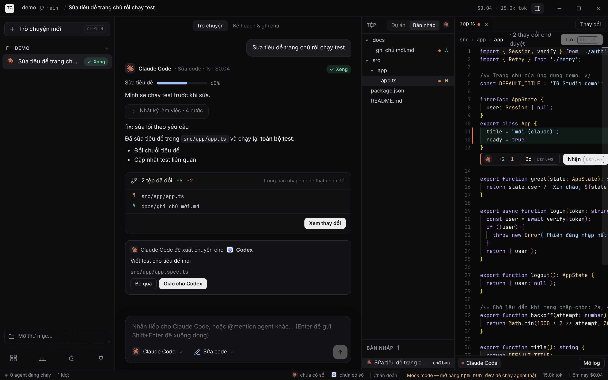
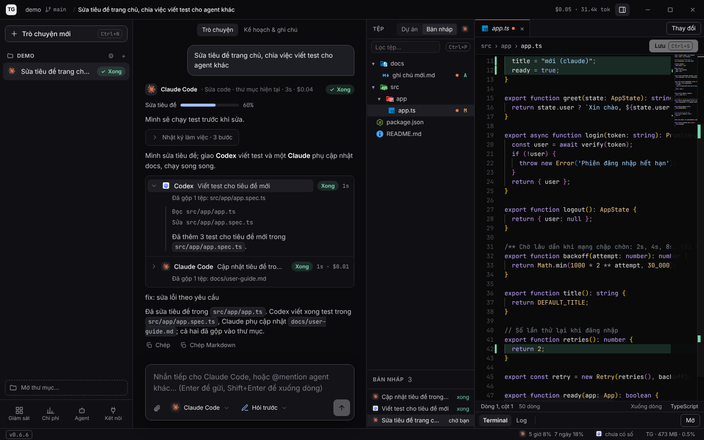
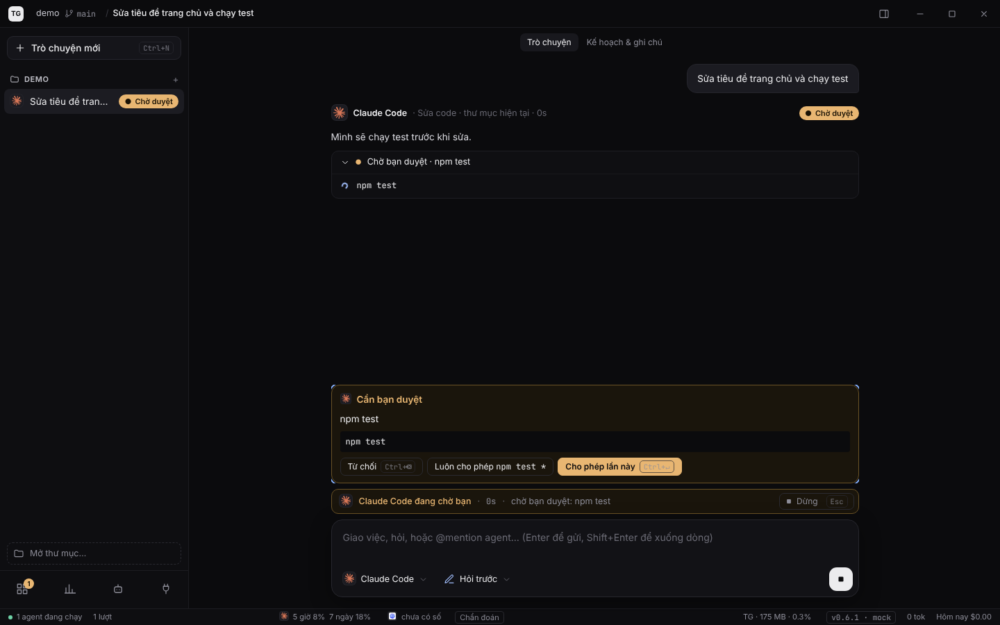
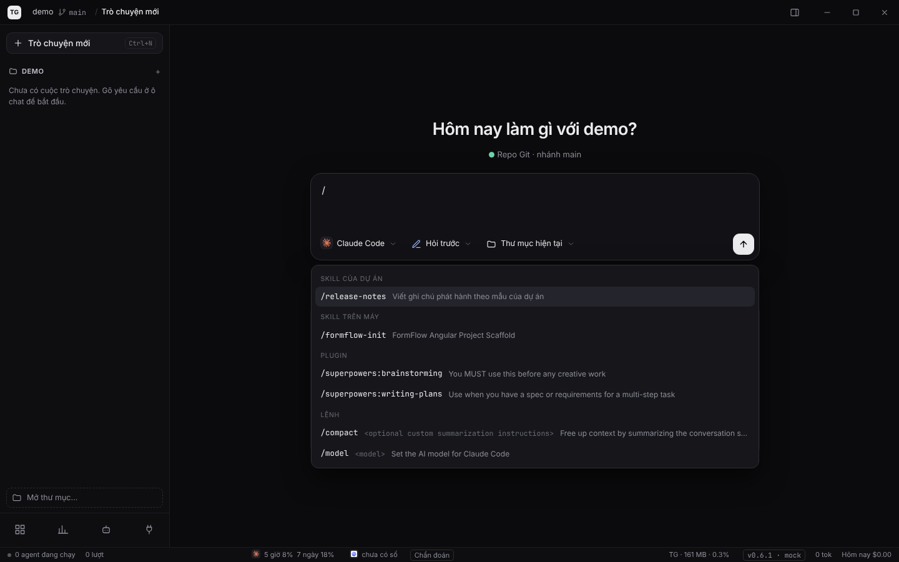
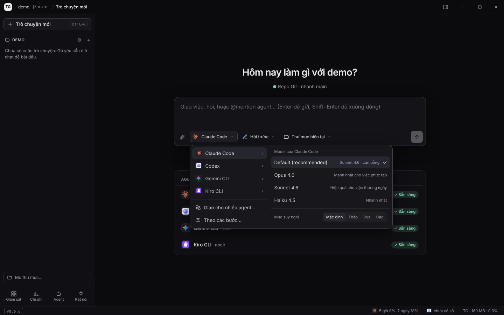
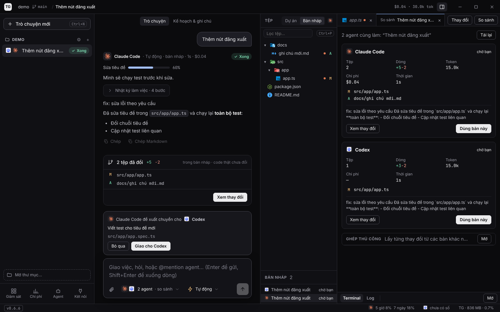
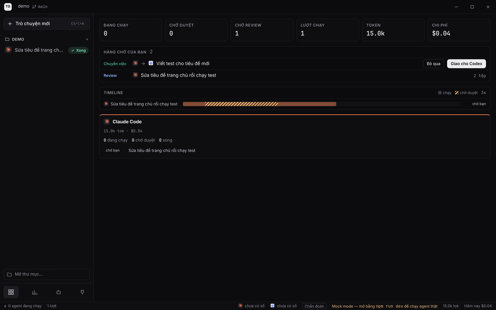
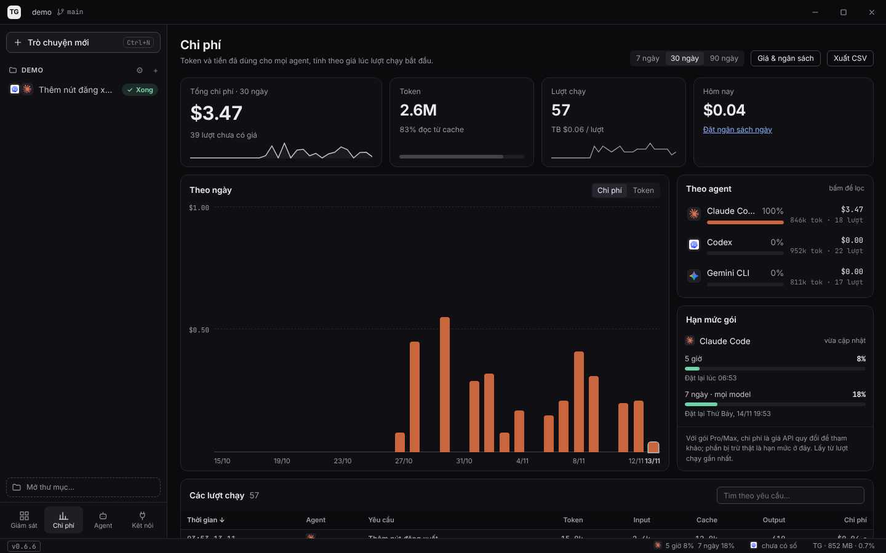

# TG Studio

App desktop để chat và giao việc cho nhiều coding agent (**Claude Code, Codex, Gemini CLI, Kiro CLI**) trên cùng một dự án. Chạy trên macOS và Windows; giao diện Angular, lõi Rust (Tauri 2).

> **Trạng thái: v0.6.1, mốc M5 của đợt làm lại trải nghiệm chính (chat-first).**
>
> Đã có:
> - chat nhiều câu trong một phiên agent, 3 quyền (Chỉ hỏi, Hỏi trước, Tự động), làm thẳng trong thư mục hoặc trong bản nháp;
> - tab Thay đổi kiểu git: commit hoặc hoàn tác theo tệp;
> - agent tự giao một phần việc cho agent khác, hiện lồng trong cuộc trò chuyện;
> - chạy song song, so sánh và ghép kết quả, Theo các bước, Giám sát;
> - Chi phí: giá, ngân sách, CSV, hạn mức gói Claude và Codex;
> - MCP, gọi skill bằng `/`, báo khi có bản mới.
>
> Đã kiểm chứng với Claude và Codex thật; Gemini, Kiro và phần agent con chưa.
>
> Còn lại: nghiệm thu trên máy thật macOS và Windows, ký số, tự cập nhật. Xem [docs/02-roadmap.md](docs/02-roadmap.md); cách dùng: [docs/user-guide.md](docs/user-guide.md).

## Giao diện

**Chat với agent:** cột trái là dự án và các cuộc trò chuyện, có nhãn trạng thái (Đang làm, Chờ duyệt, Xong, Lỗi). Các bước agent làm gom vào một dòng Nhật ký làm việc, câu trả lời hiển thị Markdown.

**Thay đổi kiểu git:** tab Thay đổi giống Source Control. Đầu tab ghi tổng (ví dụ "12 tệp · +340 −120") và có ô nội dung commit gợi ý sẵn từ yêu cầu. Tệp chia hai nhóm: tệp agent sửa (mặc định chọn để commit) và tệp bạn tự sửa trước đó (mặc định không chọn). Commit chỉ lấy tệp đã chọn. Hoàn tác trả tệp về đúng như trước khi agent sửa, không về commit cuối, nên phần bạn đang sửa dở không mất.



**Agent con:** khi task có phần làm độc lập được, agent đang làm (ví dụ Claude) tự giao phần đó cho Codex hoặc một Claude khác chạy song song.

- Ở Tự động thì agent tự giao, tự đợi và tự gộp kết quả. Ở Hỏi trước thì app hỏi bạn trước khi giao.
- Mỗi agent con là một dòng lồng trong tin nhắn của agent đã giao: trạng thái, thời gian, chi phí, bước đang làm. Bấm vào để xem nhật ký của nó.
- Subagent có sẵn của Claude Code cũng hiện như vậy.



**Duyệt lệnh:** thẻ duyệt ghim ngay trên ô chat, kể cả thẻ của agent con.



**Gọi skill:** gõ `/` ở đầu ô chat (Codex: `$`) để chọn skill của dự án, của máy, của plugin hoặc lệnh của agent. Danh sách đọc từ chính agent, không tốn token.



**Chọn agent, model và quyền:** danh sách model và mức suy nghĩ đọc từ chính CLI. Cuối menu là Giao cho nhiều agent và Theo các bước.



**Chạy song song và so sánh:** cùng một yêu cầu cho nhiều agent, chọn một bản hoặc ghép từng thay đổi rồi chạy test trên bản ghép.



**Giám sát:** hàng chờ việc của bạn, timeline có đoạn chờ duyệt, một cột cho mỗi agent.



**Chi phí:** chi phí và token theo ngày theo agent, bảng giá, ngân sách, xuất CSV. Thanh dưới cùng hiện hạn mức gói 5 giờ / 7 ngày (bấm để cập nhật), tài nguyên máy và phiên bản đang chạy.



<sub>Ảnh chụp ở chế độ mock (`npm start`), dữ liệu là mẫu. Chụp lại: `npm start -- --port 4321` rồi chạy `scripts/capture-screens.js` bằng Playwright.</sub>

**Review giao diện:** mở `docs/ui-review/index.html` trong trình duyệt.
- **Toàn cảnh** xếp các màn hình theo luồng trên một bảng kéo, phóng to được.
- **▶ Trình chiếu** chạy lần lượt từng màn kèm chú thích.
- **Review** để đánh dấu Đạt / Cần sửa và chép kết quả.

## Cài môi trường (một lần)

macOS:

```bash
xcode-select --install
```

```bash
curl --proto '=https' --tlsv1.2 -sSf https://sh.rustup.rs | sh
```

Cần Node 20 trở lên (`node -v`; dùng nvm cũng được).

Windows: cài Rust (rustup), Node 20+, và *Visual Studio Build Tools* với gói "Desktop development with C++".

Agent nào muốn dùng thì cài CLI của agent đó và đăng nhập một lần trong terminal (`claude`, `codex`, `gemini`, `kiro-cli`). Chế độ Sửa code chạy qua adapter ACP; cài sẵn thì khỏi tải bằng `npx` mỗi lần mở phiên:

```bash
npm i -g @agentclientprotocol/claude-agent-acp@0.100.0 @agentclientprotocol/codex-acp@2.5.0
```

## Chạy

```bash
npm install
```

```bash
npm run dev          # app desktop (Angular + Tauri), sửa code là tự reload
```

```bash
npm start            # chỉ UI trong trình duyệt, chế độ mock, không cần Rust
```

Lần đầu `npm run dev` tải và biên dịch các crate Rust, mất vài phút; những lần sau nhanh.

Kiểm tra trước khi xong việc:

```bash
npm run build
```

```bash
npm test -- --watch=false
```

```bash
(cd src-tauri && cargo test)
```

Đóng gói: `npm run build:app` (bộ cài của máy đang chạy, ở `src-tauri/target/release/bundle/`) hoặc `npm run build:mac` (macOS universal). Mỗi bản gửi đi đều nâng phiên bản bằng `npm run release -- patch|minor|major`. Chi tiết, kể cả trang tải cho người ngoài repo: [docs/07-release.md](docs/07-release.md).

## Dùng thử

1. Lần đầu mở, hướng dẫn dò CLI, đăng nhập và chọn thư mục dự án.
2. Gõ yêu cầu ở ô chat giữa màn hình, chọn agent và quyền (Chỉ hỏi, Hỏi trước, Tự động), rồi Enter.
3. Duyệt lệnh khi agent hỏi. Xong thì mở tab **Thay đổi**, chọn tệp và **Commit**, hoặc hoàn tác.

Gợi ý câu đầu tiên: *"Giải thích cấu trúc thư mục này trong 5 gạch đầu dòng"* (chỉ đọc tệp, không sửa gì).

Chi tiết: [docs/user-guide.md](docs/user-guide.md).

## Lưu ý

- **Quyền:** Chỉ hỏi chạy với cờ chặn ghi của CLI (Claude `--permission-mode plan`, Codex `--sandbox read-only`); Gemini và Kiro không có cờ đó nên chạy qua ACP trong bản nháp tạm. Hỏi trước và Tự động chạy qua ACP; ở Tự động, lệnh nằm trong danh sách cấm vẫn bị chặn.
- **Sửa code** cần thư mục là repo Git có ít nhất một commit; nếu chưa có, app đề nghị khởi tạo.
- **Kiro CLI:** không có chế độ headless, chỉ chạy qua ACP (`kiro-cli acp`); chưa kiểm chứng với Kiro thật.
- **Chi phí:** Claude Code tự báo tiền. Codex, Gemini chỉ có token; nhập bảng giá ở màn Chi phí để ước tính.
- **PATH trên macOS:** app mở từ Finder không thấy PATH của terminal (nvm, Homebrew). Lõi Rust tự hỏi login shell và thêm các thư mục cài quen thuộc; xem `src-tauri/src/system/env.rs`.

## Cấu trúc

```
src/app/                 giao diện, chia theo tính năng
  chat/                  ô chat, dòng chat, thẻ duyệt, agent con (delegations)
  workspace/             cây tệp, editor Monaco, tab Thay đổi, so sánh và ghép
  runs/                  run, cuộc trò chuyện, Theo các bước, Giám sát
  agents/                dò agent, model, onboarding
  usage/                 Chi phí, giá, ngân sách, hạn mức
  integrations/          MCP, skills, tg-bridge
  shell/                 khung app: cột trái, thanh tiêu đề, thanh dưới
  shared/                tiện ích dùng chung
  core/                  protocol (kiểu chung với Rust), backend (Tauri | mock)
src-tauri/src/           lõi Rust
  agents/                danh sách agent, dò CLI, model và lệnh của agent
  acp/                   ACP client (JSON-RPC), fs và terminal cho agent
  tasks/                 task sửa code: phiên, thay đổi, agent con, phiên mở sẵn
  workspace/             dự án, worktree, diff, ghép
  integrations/          tg-bridge, MCP, skills, chính sách lệnh
  usage/                 chuẩn hoá token và chi phí, sổ usage
  store/                 lịch sử (SQLite)
  system/                PATH, tài nguyên, chẩn đoán, phiên bản
docs/ARCHITECTURE.md     kiến trúc và hợp đồng sự kiện
```

## Tài liệu

| File | Nội dung |
|---|---|
| [docs/user-guide.md](docs/user-guide.md) | Hướng dẫn sử dụng |
| [docs/ARCHITECTURE.md](docs/ARCHITECTURE.md) | Kiến trúc code, hợp đồng sự kiện |
| [docs/01-product-spec.md](docs/01-product-spec.md) | Tầm nhìn, người dùng, tính năng từng màn |
| [docs/02-roadmap.md](docs/02-roadmap.md) | Lộ trình, checklist, rủi ro |
| [docs/03-agent-integration.md](docs/03-agent-integration.md) | ACP và headless, từng agent, luồng quyền, worktree |
| [docs/04-usage-and-cost.md](docs/04-usage-and-cost.md) | Token, chi phí, hạn mức, sổ usage, ngân sách |
| [docs/05-mcp-skills-plugins.md](docs/05-mcp-skills-plugins.md) | MCP, skills, tg-bridge |
| [docs/06-design-system.md](docs/06-design-system.md) | Màu, chữ, component, trợ năng |
| [docs/07-release.md](docs/07-release.md) | Phát hành, ký số, trang tải, CI |
| [docs/superpowers/specs/](docs/superpowers/specs/) | Thiết kế: chat-first, agent con và thay đổi kiểu git |
| [CHANGELOG.md](CHANGELOG.md) | Thay đổi theo phiên bản |

## Lộ trình

Đang làm lại trải nghiệm chính theo [thiết kế chat-first](docs/superpowers/specs/2026-11-04-chat-first-design.md), M-D và M1–M4 đã xong; M0 (Windows) và M5 đã xong phần code, còn nghiệm thu trên máy thật macOS và Windows. Đóng gói (ký số, notarize, tự cập nhật) tạm dừng tới sau M5 vì cần tài khoản và chứng chỉ của chủ repo. Chi tiết: [docs/02-roadmap.md](docs/02-roadmap.md).
